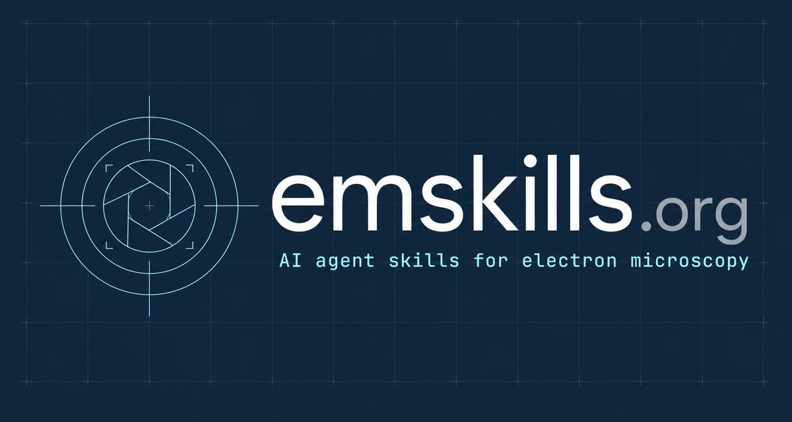

<p align="center">
  
</p>

# em-skills

Canonical registry source for [emskills](https://emskills.org). Every folder under
`skills/` holds one skill with a `SKILL.md` manifest that the registry importer reads.

```
skills/<slug>/SKILL.md        # required manifest + instructions
skills/<slug>/examples/       # sample tool call + expected output
skills/<slug>/fixtures/       # small deterministic test input
```

Required front-matter keys: name, slug, technique, category, kind, summary,
license, version, runtime, tool_call. Required body sections: Scope, Safety, Usage.

Techniques: SEM, TEM, STEM, EDS, EELS, cryo-EM, FIB.

## Validating

Every skill must pass the registry contract checker before it can be
imported by the website:

```bash
pip install -r requirements-dev.txt
python3 scripts/validate_skills.py --run
```

It checks front-matter completeness, semver, slug/name/folder consistency,
required body sections, that the `Usage` JSON block and `examples/invoke.json`
agree with `tool_call`, that `fixtures/` referenced by a skill actually exists
and is non-empty, that a `verify.py`/`requirements.txt` (or `verify.js`/
`package.json` for `node` runtimes) exists per the declared runtime, and that
the `## Skills` index below matches the `skills/` directory. Pass `--run` to
also execute each skill's `## Reproducibility` command for real and require
it to exit 0 — that's the actual regression test: each skill ships a
deterministic synthetic `fixtures/sample/` (see each skill's
`fixtures/generate.py`/`generate.js` for its provenance) and a small
reference implementation in `verify.py`/`verify.js` that must recover the
fixture's known ground truth. CI runs `--run` on every push and pull request
via [`.github/workflows/validate.yml`](.github/workflows/validate.yml).

## Skills
- [`cryo2d-classify`](skills/cryo2d-classify/SKILL.md) — Reference-free 2D classification of particle micrographs with a motion-correction pre-pass.
- [`edax-phase-map`](skills/edax-phase-map/SKILL.md) — Phase mapping from dispersive spectra with peak deconvolution and ZAF correction.
- [`ctf-fitter`](skills/ctf-fitter/SKILL.md) — Per-tilt CTF estimation and refinement with amorphous-carbon reference subtraction.
- [`fib-mill-seg`](skills/fib-mill-seg/SKILL.md) — Mill-volume segmentation and lift-out path planning for serial sectioning.
- [`sem-topography`](skills/sem-topography/SKILL.md) — 3D surface relief reconstruction from four-quadrant backscattered stacks.
- [`eels-edge-id`](skills/eels-edge-id/SKILL.md) — Core-loss edge identification and oxidation-state fingerprinting.
- [`stem-drift-lock`](skills/stem-drift-lock/SKILL.md) — Closed-loop drift correction for long atomic-resolution acquisitions.
- [`tomo-align`](skills/tomo-align/SKILL.md) — Fiducial-free tilt-series alignment with confidence-weighted reconstruction.
- [`grid-atlas-qc`](skills/grid-atlas-qc/SKILL.md) — Ice-thickness estimation and automated grid-square quality triage.
- [`scalebar-calibrate`](skills/scalebar-calibrate/SKILL.md) — Magnification calibration against certified cross-grating standards.
- [`particle-picker`](skills/particle-picker/SKILL.md) — Template-free particle picking tuned for low signal-to-noise micrographs.
- [`lattice-dspacing`](skills/lattice-dspacing/SKILL.md) — Bayesian d-spacing measurement and lattice fitting from HRSTEM images.
- [`sem-particle-size`](skills/sem-particle-size/SKILL.md) — Particle sizing in calibrated nm from any NUANCE SEM file, with provenance.
- [`provenance-verify`](skills/provenance-verify/SKILL.md) — Check that a microscopy file is unchanged since it was sealed, and who signed it.
- [`fib-phase-fractions`](skills/fib-phase-fractions/SKILL.md) — Phase volume fractions of a FIB-SEM volume with sampling error bars.

## Skills backed by NUScope

`sem-particle-size`, `provenance-verify` and `fib-phase-fractions` are served by the
[NUScope](https://github.com/NUANCE-IT/NUScope) and [NUScope-TOMO](https://github.com/NUANCE-IT/NUScope-TOMO)
plugins of [NUANCE-MCP](https://github.com/NUANCE-IT/NUANCE-MCP): `pip install nuance-mcp nuscope nuscope-tomo`.
Their tools read every NUANCE instrument's files with calibration from metadata, and the server saves every
acquisition as a sealed, signed file carrying the DataCite DOI of the instrument. Each skill pins the released
package and its `verify.py` recovers the fixture's ground truth with it. The design (layers, rules for agents,
which existing skills NUScope can serve) is in the
[NUScope guide](https://nuance-it.github.io/NUScope/guide/llm/).

## License

Licensing works at two levels here:

- **This repo's tooling** (`scripts/`, the validator, CI config, docs) is
  licensed under the [MIT License](LICENSE).
- **Each skill** carries its own license, declared in its `SKILL.md`
  front-matter (`license:`, an SPDX identifier) and governing that skill's
  implementation as maintained in its origin repo (`org`/`repo`). Skills in
  this registry currently use MIT, Apache-2.0, or BSD-3-Clause — check the
  individual skill's front-matter before redistributing its implementation,
  since it may differ from this repo's own MIT license.
